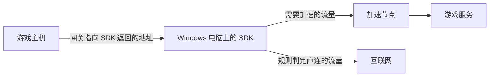

# 使用 Lingti SDK 加速游戏主机

本教程面向接入 Lingti SDK 的开发者，演示如何在 **Windows x64 电脑**上运行 SDK，为同一路由器下的 Nintendo Switch、PS4 / PS5、Xbox 提供加速。完成后，你的程序会显示主机需要填写的网络参数，并在玩家游戏期间持续转发流量。

基本流程是：**获取主机游戏的加密配置 → 启动 SDK → 等待网络参数就绪 → 在主机上填写参数 → 联网验证 → 结束时停止 SDK 并恢复主机网络。**

## 1. 准备电脑和网络

- 一台能正常联网的 Windows x64 电脑，运行 SDK 的进程需要管理员权限。
- 一台游戏主机，与电脑接入同一路由器的局域网；有线或 Wi-Fi 均可，但设备之间必须能互通。不要使用相互隔离的访客网络。
- 与接口版本匹配的 `lingti_sdk.dll`、`lingti_sdk.lib`、`lingti_sdk.h` 和 `lingtiwfp64.sys`。
- 一份为目标主机游戏和线路生成的有效加密配置。

SDK 运行在电脑上。主机通过手动网关把流量交给电脑，电脑再按游戏配置转发到加速线路；游戏期间要保持电脑联网、不休眠，并保持 SDK 进程运行。



上图表示流量路径。物理连接上，电脑和主机都接入同一路由器。本教程采用普通局域网模式；Windows 移动热点需要匹配的热点配置，不能直接套用这里的手动 IP 步骤。

## 2. 获取主机游戏的加密配置

1. 打开 [Lingti SDK 配置生成页](https://game.lingti.com/sdk)，按页面要求登录。
2. 选择目标主机对应的游戏条目，并选择线路。注意区分同名游戏的 PC 版本和主机版本。
3. 生成并下载 `encrypted_config.txt`，保存到电脑上容易找到的位置，例如 `C:\lingti-demo\encrypted_config.txt`。

配置页提供测试配置，页面注明有效期为 **1 小时**；失效后重新生成。正式集成应通过接入方获授权的配置获取流程取得配置。企业专用配置应与同一企业配套的 DLL 一起使用。[配置页说明](https://game.lingti.com/sdk)

当前服务端依据所选游戏条目生成主机模式：

| 游戏条目 ID 前缀 | 加密配置中的模式 |
| --- | --- |
| `SWITCH_` | `tun_switch` |
| `PS4_` | `tun_ps4`，用于相应的 PlayStation 主机条目 |
| `XBOX_` | `tun_xbox` |

以配置页实际提供的条目为准，PS5 接入也需要选择对应的主机游戏条目，不要自行拼接游戏 ID。如果找不到所需条目，请让接入方提供该游戏的有效配置。

`encrypted_config.txt` 中只放生成的加密文本，不要放整个接口响应、JSON 对象、引号或说明文字。自行保存时使用 UTF-8 无 BOM 文本。

**启动接口接收的是加密文本。** 虽然部分接口注释仍将参数称为 JSON，当前 SDK 会先解密再解析；下面这种直接传对象的写法不能用于启动：

```javascript
// 错误：不能用手写明文对象替代服务端生成的加密配置。
lingti.startTun2R({ Mode: 'tun_switch', Server: '...', Token: '...' });
```

如果配置来自后端响应，应先检查业务返回成功，再把返回的 `config` 字符串交给 SDK：

```javascript
// encryptedConfig 是后端返回的有效加密字符串。
const result = lingti.startTun2R(encryptedConfig);
```

不要把配置或其中的凭证写入公开日志、截图或代码仓库。

## 3. 在电脑上启动 SDK

选择 Node.js 或 C 中的一种方式即可。两者都必须持续运行，不能启动后立即结束进程。

### 方式 A：Node.js

完整示例见 [console-example.js](../node-addon/console-example.js)。它会等待网络参数、每秒读取流量，并在按下 `Ctrl+C` 后停止服务。

准备 Windows x64 Node.js、Python 3 和包含 C++ 构建工具的 Visual Studio。仓库声明 Node.js 最低版本为 16，实际使用时应选择仍受支持、与构建工具兼容的版本。

以下命令在仓库根目录执行。先将同一套发行包的 DLL、导入库、头文件和驱动放到根目录，再构建扩展：

```powershell
Copy-Item .\lingti_sdk.dll, .\lingti_sdk.lib, .\lingti_sdk.h, .\lingtiwfp64.sys -Destination .\node-addon\
Set-Location .\node-addon
npm install
```

构建配置会把 DLL 和驱动复制到 `node-addon\build\Release\`。运行时应能在该目录找到 `lingti_sdk.node`、`lingti_sdk.dll`、`lingtiwfp64.sys`。

以管理员身份打开 PowerShell，进入 `node-addon` 目录，执行：

```powershell
node .\console-example.js "C:\lingti-demo\encrypted_config.txt"
```

示例使用仓库内的 `require('./index')`。集成到自己的项目时改为 `require('lingti-sdk')`，并安装经过确认的 npm 发行版本。可先运行 `npm view lingti-sdk version` 核对版本；**仓库版本与 npm 默认版本可能不同**，不要混用不同发行包的 DLL、导入库和头文件。

关键调用是：

```javascript
const result = lingti.startTun2RWithConfigFile(configPath);
// result === 0 后，仍需轮询状态。
const config = lingti.getConsoleConfig();
// config.state === 0 且四个地址字段有效后，再展示给玩家填写。
// 游戏期间持续调用 isServiceRunning() 和 getTrafficStats()。
// 玩家结束加速时调用 stopTun2R()。
```

### 方式 B：C / C++

完整示例见 [sdk_console_example.c](../sdk_console_example.c)。它包含 30 秒启动等待、流量显示、错误输出、字符串释放和 `Ctrl+C` 清理。

在 Visual Studio 的 **x64 Native Tools Command Prompt** 中进入仓库根目录编译：

```bat
cl /nologo /W4 /MD sdk_console_example.c lingti_sdk.lib /Fe:sdk_console_example.exe
```

也可以使用 Windows x64 MinGW：

```bat
gcc -Wall -Wextra sdk_console_example.c lingti_sdk.lib -o sdk_console_example.exe
```

将生成的 EXE、`lingti_sdk.dll` 和 `lingtiwfp64.sys` 放在同一目录，以管理员身份执行：

```bat
sdk_console_example.exe "C:\lingti-demo\encrypted_config.txt"
```

C 接口获取主机参数的顺序是 **网关、掩码、主机 IP、DNS**：

```c
char *gateway = NULL, *mask = NULL, *ip = NULL, *dns = NULL;
int state = GetConsoleConfig(&gateway, &mask, &ip, &dns);

/* 使用参数后，每次调用分配的四个字符串都要释放，包括尚未就绪时。 */
free(gateway);
free(mask);
free(ip);
free(dns);
```

`GetSDKVersion()` 和 `GetLastErrorMessage()` 返回的字符串也需要释放。Node.js 封装会完成对应的字符串释放。

## 4. 等待主机网络参数就绪

启动函数返回 `0` 表示后台启动已发起，不代表主机已经联网。`isServiceRunning()` / `IsServiceRunning()` 也只是 SDK 的运行标志。

主机 IP 配置状态如下，C 返回整数，Node.js 使用 `ConsoleIPState`：

| 值 | Node.js 常量 | 处理方式 |
| --- | --- | --- |
| `0` | `COMPLETED` | IP 配置完成；同时检查 `ip`、`mask`、`gateway`、`dns` 都有有效值 |
| `1` | `FAILED` | 配置失败，读取错误并停止本次启动 |
| `2` | `IDLE` | 尚未配置，继续等待并检查服务是否仍在运行 |
| `3` | `IN_PROGRESS` | 正在配置，继续等待 |

两个示例每 500 毫秒检查一次，30 秒未就绪就退出并清理。这个超时是示例的应用策略，不是 SDK 的固定启动时长。等待期间服务若停止，应立即读取错误；不要只等待 `FAILED`，失败清理后状态可能已回到 `IDLE`。

就绪后可能显示以下值，**这里只是说明字段含义，实际填写必须使用本次运行的输出**：

| 主机设置项 | SDK 字段 | 示例值 |
| --- | --- | --- |
| IP 地址 | `ip` | `172.19.1.2` |
| 子网掩码 | `mask` | `255.255.255.0` |
| 默认网关 | `gateway` | `172.19.1.1` |
| 首选 DNS | `dns` | `223.5.5.5` |

这里的 `ip` 是给**游戏主机**填写的地址，`gateway` 是 SDK 在电脑侧配置的地址。不要把它们互换，也不要把家用路由器地址填进网关栏。SDK 会处理电脑侧地址，通常无需手动修改电脑网卡的 IP。

`GetConsoleConfig()` 不返回备用 DNS。需要填写备用 DNS 时，可使用当前核心默认的 `114.114.114.114`；企业接入有专门约定时使用其指定值。每次重启加速后重新读取参数，不要永久保存上次的示例 IP。

## 5. 在游戏主机上填写参数

先记录主机原来的网络设置，以便结束加速后恢复。将 IP 和 DNS 改成手动，然后逐项填写上一步的实际输出。

| 主机 | 设置入口 |
| --- | --- |
| Nintendo Switch | 设置 → 互联网 → 互联网设置 → 当前网络 → 更改设置 |
| PS5 | 设置 → 网络 → 设定 → 设定互联网连接 → 当前网络 → 高级设定 |
| PS4 | 设置 → 网络 → 设定互联网连接 → 选择 Wi-Fi 或 LAN → 自订 |
| Xbox | 设置 → 常规 → 网络设置 → 高级设置，分别进入 IP 设置和 DNS 设置 |

Switch 将 IP 地址设置和 DNS 设置改为手动，填写 IP、掩码、网关、首选 DNS 和备用 DNS，保存后测试连接。相关字段见 [Nintendo 官方网络设置说明](https://www.nintendo.com/en-gb/Support/Troubleshooting/How-to-Manually-Set-Up-a-Wireless-Internet-Connection-on-Nintendo-Switch-1494762.html)。

PS4 / PS5 同样使用手动 IP 和 DNS；代理服务器选“不使用”，MTU 保持自动。网络设置入口和高级设置项见 [PlayStation 官方说明](https://www.playstation.com/en-us/support/connectivity/internet-connect-playstation/)。Xbox 填写完成后返回网络设置执行测试。菜单名称可能随系统语言和版本略有差异。

## 6. 确认加速链路可用

按以下顺序验证：

1. **本地状态**：SDK 仍在运行，主机 IP 配置已完成且字段有效。
2. **主机联网**：执行主机的连接测试，确认能连接互联网和对应平台服务。
3. **真实游戏**：进入目标游戏，尝试登录、匹配和实际对局；同时观察 SDK 的发送、接收字节是否随游戏活动增长。

流量计数是辅助证据，不是某一局游戏已成功的证明。Switch 的部分系统测速请求由核心在本地处理，因此系统测速显示的下载速度也不能作为远端线路带宽或游戏加速效果的依据。

产品界面可以先显示“正在准备网络”，参数就绪后显示“请配置主机网络”。只有主机完成实际联网和游戏验证，才能确认这条使用路径可用。

## 7. 停止加速和恢复网络

结束游戏后，在示例窗口按 `Ctrl+C`。示例会停止 SDK、等待清理，并再次检查运行状态。

**随后将主机的 IP 地址和 DNS 改回自动获取，或恢复原有静态配置。** SDK 能清理电脑侧资源，但不会代替玩家修改主机设置。电脑已关机或 SDK 已停止时，主机继续使用加速网关可能无法联网。

切换游戏或线路时，先正常停止当前 SDK 会话，再使用新配置启动，等待并重新展示本次返回的网络参数。不要在同一进程内连续启动多个会话，也不要把同一个主机 IP 同时填给多台主机。

## 8. 常见问题

| 现象 | 排查方法 |
| --- | --- |
| 启动返回 `-5` | 以管理员权限运行实际加载 SDK 的进程；只提升安装器权限不够 |
| 启动返回 `-4` | 检查配置文件存在、可读，并传入明确的文件路径 |
| 启动返回 `-2` | 检查是否误传明文 JSON、整个响应或带 BOM 的文本；确认加密配置与 DLL 配套 |
| 启动返回 `-3` | 当前服务已运行，先完成停止流程，再启动新配置 |
| 返回 `0`，随后服务停止 | 立即读取最后错误；检查驱动加载、网卡和线路初始化错误 |
| 长时间没有主机 IP | 确认下载的是主机游戏配置，而非 PC 游戏配置；确认电脑有已连接的 IPv4 网卡 |
| IP 配置失败或网关不可达 | 检查网卡状态、地址冲突，以及电脑和主机是否处在可互通的局域网；多网卡电脑还需确认 SDK 选中的网卡能到达主机 |
| 网络参数已就绪，但主机不能联网 | 逐项核对 IP、掩码、网关、DNS，确认电脑未休眠、SDK 未退出，检查访客网络或 AP 隔离 |
| 能联网，但游戏仍失败或没有相关流量 | 检查游戏条目、线路、配置有效期；进入真实游戏验证，并结合日志和流量判断 |
| Node.js 原生扩展不可用 | 确认 Windows x64 / Node.js 架构、C++ 构建环境，以及 `build\Release` 中的原生扩展、DLL 和驱动 |
| 停止后主机无法上网 | 将主机 IP 和 DNS 恢复为自动获取或原值，再重新连接网络 |

排查时同时保留启动返回码、最后错误、运行状态和主机 IP 状态。遇到错误先记录，再做停止清理，避免后续调用覆盖错误信息。更多接口定义见 [C 头文件](../lingti_sdk.h) 和 [Node.js API 文档](../node-addon/docs/API.zh-CN.md)。
